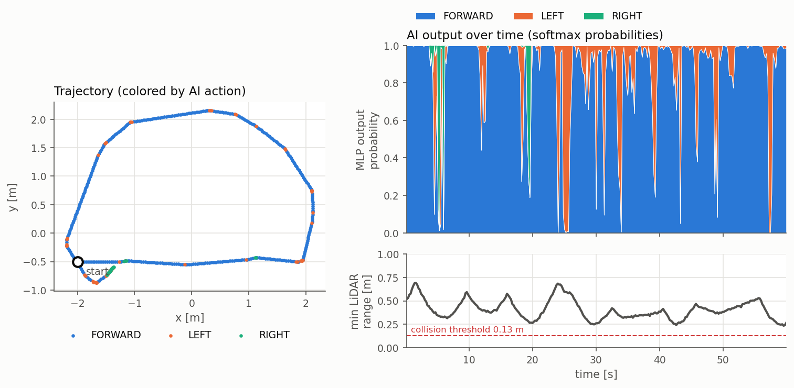
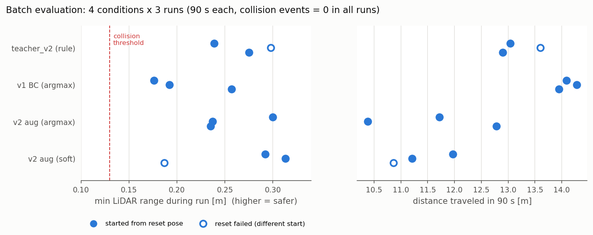

# TB3 AI Navigator — LiDAR × 模倣学習による TurtleBot3 自律走行

ROS 2 Humble / Gazebo Classic 11 / TurtleBot3 Burger 上で、**LiDAR (`/scan`) を入力とするニューラルネットワーク (MLP) の推論結果**で前進・左旋回・右旋回を選び、`/cmd_vel` に速度指令を出して自律走行するシステムです。

ルールベースの「教師」の振る舞いを、Gazebo 内で自動収集したデータから **模倣学習 (Behavior Cloning)** で MLP に学習させ、走行中は **MLP の推論だけ** で行動を決めます。

- 最終採用モデル: `models/policy_v2_aug.pt`（72セクタ入力、データ拡張あり）、制御方式は argmax（既定）
- 初心者向けの詳しい技術解説: [`docs/TECH_GUIDE.md`](docs/TECH_GUIDE.md)



## システム構成

```
/scan (LaserScan, 360本, 約5Hz)
   │  前処理: inf/nan→3.5m, 5°ごと72セクタの最小距離, ÷3.5で正規化
   ▼
72次元特徴量 ──► MLP (72-128-128-3, ReLU) ──► softmax 確率 [前進, 左, 右]
                                                │
                     ┌──────────────────────────┴─────────────────────────┐
                 argmax制御(既定): 最大確率の行動        soft制御: 確率で速度を重み付け平均
                     └──────────────► /cmd_vel (Twist) ◄──────────────────┘
                     行動ごとの速度  前進: v=0.18 m/s, ω=0 ／ 左右: v=0.02 m/s, ω=±0.9 rad/s

  /ai_nav/probs (Float32MultiArray) ──► ai_monitor.py（LiDARと確率の可視化。制御には関与しない）
```

## AIモデルの説明

| 項目 | 内容 |
|---|---|
| モデル | 多層パーセプトロン (PyTorch)。入力72 → 隠れ層128×2 (ReLU) → 出力3 |
| 入力 | LiDAR 360本を5°ごとの72セクタに分け、各セクタの最小距離を 0〜1 に正規化したもの |
| 出力 | 3行動 (FORWARD / LEFT / RIGHT) の確率 (softmax) |
| 学習方法 | **模倣学習 (Behavior Cloning)**。教師あり3クラス分類、クラス重み付き交差エントロピー、Adam (lr=1e-3) |
| 学習データ | Gazebo (turtlebot3_world) を走行しながら自動収集した (生LiDAR 360本, 行動ラベル) 3,206組。学習側のみ左右反転＋ノイズで約25,650組に拡張 |
| **正解ラベル** | **ルールベースの教師 (`scripts/common.py` の `teacher_action_v2`) で自動生成**。人間の操作データではない |
| 推論 | `/scan` を受信するたびに (約5Hz) CPU で1回推論 |

### 教師ルール（正解ラベルの生成規則） `teacher_action_v2`
1. 前方±30°が 0.55m 以上、斜め前 (30〜75°) が 0.35m 以上空いていれば **前進**
   - ただし真横 (75〜105°) に 0.22m 未満の壁があれば、その壁から離れる方向へ旋回
2. それ以外は、左右 (20〜100°) の平均距離が大きい方へ **旋回**

### AIの役割と限界
- 走行中の行動決定は **MLPの推論のみ** で行います (`scripts/ai_driver.py`)。教師ルールは走行中、評価指標「教師一致率」を計算するためだけに呼び出しており、制御には使っていません（`--driver teacher` を指定した比較用ベースラインを除く）。
- 正解ラベルをルールで生成しているため、**モデルの性能の上限は基本的に教師ルールと同程度**です。AIが教師より賢くなるわけではありません。
- MLPは教師を完全には再現できません（検証精度は約87%）。
- 地図も自己位置推定も持たない反応型の方策なので、ゴールへの到達や探索はできません。turtlebot3_world 以外の環境や実機での性能は検証していません。

## ディレクトリ構成

```
tb3_ai_nav/
├── scripts/
│   ├── common.py         特徴量抽出・行動定義・教師ルール(v1, v2)・モデル定義
│   ├── collect_data.py   Gazeboで走行しながらデータ収集（教師走行 / DAgger）
│   ├── train.py          MLPの学習（再ラベル付け・データ拡張・検証精度・混同行列）
│   ├── policy.py         学習済みモデルの読み込みと推論
│   ├── ai_driver.py      AI自律走行ノード（評価ログ付き）
│   ├── ai_monitor.py     AI視点モニター（LiDARと行動確率の表示）
│   ├── eval_all.sh       4条件×3回の一括評価
│   ├── summarize.py      評価結果の集計
│   ├── audit_runs.py     評価ログの事後分析（初期位置・探索範囲・周回・立ち往生）
│   ├── plot_run.py / plot_eval.py   図の作成
│   ├── run_demo.sh / record_demo.sh デモ動画の撮影（モニター＋走行＋ffmpeg録画）
│   └── arrange_windows.py / gazebo_view.py  撮影用の画面整理（VNC上のウィンドウ配置・Gazeboの表示調整）
├── data/                 収集データ (.npz: 特徴量 X, ラベル y, 生LiDAR raw)
├── models/               学習済みモデル (.pt) と学習指標 (_metrics.json)
├── logs/                 走行ログ (.csv) と評価サマリ (_summary.json)。logs/eval が一括評価
├── figs/                 図
├── docs/TECH_GUIDE.md    技術解説（初心者向け）
├── report/report.html    提出用レポートの元データ
└── sync_*.ps1            開発用: Windows⇔Dockerコンテナの同期
```

## 実行手順

前提: Ubuntu 22.04、ROS 2 Humble、Gazebo 11、`turtlebot3_gazebo` パッケージ、Python 3.10、PyTorch（開発環境は 2.6.0）、numpy、OpenCV（モニター用）、matplotlib（図の作成用）。

```bash
# 1. シミュレーション起動（別ターミナル）
export TURTLEBOT3_MODEL=burger
ros2 launch turtlebot3_gazebo turtlebot3_world.launch.py
# ※ teleop_keyboard は停止しておくこと（/cmd_vel を常時publishしてAIの指令と競合するため）

cd tb3_ai_nav

# 2. AI自律走行（学習済みモデル同梱。Ctrl+Cで停止）
python3 scripts/ai_driver.py --model models/policy_v2_aug.pt --reset
#   --control soft   : 確率で速度を重み付け平均する制御
#   --duration 120   : 120秒で自動停止

# 3. (任意) AI視点モニター（別ターミナル。ai_driver と同じユーザーで実行すること）
python3 scripts/ai_monitor.py
```

> 注: Docker 内で root と別ユーザーが混在すると、FastDDS の共有メモリ通信により `/ai_nav/probs` がモニターに届かないことがありました。`ai_driver.py` と `ai_monitor.py` は同じユーザーで起動してください。

### 学習を最初から再現する場合

```bash
# データ収集（教師ルールで走行。ε=0.1でランダム行動を混ぜて状態を多様化）
python3 scripts/collect_data.py --policy teacher --duration 240 --out data/teacher_v2.npz
# DAgger: 学習済みモデルで走行し、その状態に教師ラベルを付けて収集（本作品では v1 で実施）
python3 scripts/collect_data.py --policy student --model models/policy.pt --beta 0.3 --epsilon 0.05 --duration 180 --out data/dagger1.npz

# 学習（全データを教師v2で再ラベル、72セクタ、データ拡張）
python3 scripts/train.py data/teacher.npz data/dagger1.npz data/teacher_v2.npz \
    --relabel --sectors 72 --augment 4 --hidden 128 --epochs 150 --out models/policy_v2_aug.pt

# 一括評価（各条件 N 回 × DURATION 秒）と事後分析
N=3 DURATION=90 bash scripts/eval_all.sh
python3 scripts/audit_runs.py logs/eval
```

> `data/teacher.npz` と `data/dagger1.npz` は教師 v1 のときに収集したデータです。`--relabel` を付けると、保存してある生LiDAR値から教師 v2 でラベルを付け直します。

## 実験の経緯

| 段階 | 内容 | 結果 |
|---|---|---|
| v1 | 教師 v1 で1,176件を収集し、24セクタMLPを学習 | 検証精度91.1%。120秒の走行で衝突イベント0回 |
| DAgger | v1モデルが走行したときの状態863件に教師v1のラベルを付けて追加 | 検証精度93.9%に上がったが、**同じ条件の走行で衝突イベント6回**（悪化） |
| 教師v2 | 真横 (75〜105°) の確認を教師に追加し、全データを再ラベル | – |
| 72セクタ | 教師の角度境界と特徴量のセクタ境界がずれないよう5°刻みに変更 | 検証精度88.3% |
| データ拡張 | 左右反転＋距離ノイズ (σ=2cm) を加えて教師で再ラベル | 検証精度87.2%（**最終採用**） |
| soft制御 | 確率で速度を重み付け平均する制御を追加 | – |

### 学習（検証データでの精度）
| モデル | 教師 | 特徴量 | データ | 検証精度 |
|---|---|---|---|---|
| `policy.pt` (v1) | v1 | 24セクタ | 教師走行 1,176 | 91.1% |
| `policy_dagger1.pt` | v1 | 24セクタ | + DAgger 863 | 93.9% |
| `policy_v2_s24.pt` | v2 | 24セクタ | 3データを再ラベル 3,206 | 87.1% |
| `policy_v2_s72.pt` | v2 | 72セクタ | 同上 | 88.3% |
| `policy_v2_aug.pt` | v2 | 72セクタ | 同上 + 拡張（学習側 25,650） | 87.2% |

※ 教師が異なる v1 系と v2 系の精度は、直接比較できません。検証データは同じデータから無作為に20%を抜き出したもので、走行とは別の環境を使ったテストではありません。

### 予備評価（各120秒・1回ずつ）
| 条件 | 初期位置 | 走行距離 | 最接近距離 | 衝突イベント | 教師一致率 |
|---|---|---|---|---|---|
| 教師 v1（ルールで走行） | リセット | 18.6 m | 0.198 m | 0 | – |
| v1 BC | リセット | 19.0 m | 0.150 m | 0 | 87%（対v1） |
| v1 + DAgger | リセット | 16.7 m | 0.120 m | **6** | 72%（対v1） |
| 教師 v2（ルールで走行） | リセット | 16.4 m | 0.234 m | 0 | – |
| v2 (72セクタ) | リセット | 16.8 m | 0.165 m | 0 | 82%（対v2） |
| v2 aug (72セクタ+拡張) | リセット | 16.4 m | 0.246 m | 0 | 81%（対v2） |

## 一括評価（4条件 × 3回 × 90秒）

`scripts/eval_all.sh` で、各試行の開始時に `/reset_world` を呼び、続けて実行しました。

| 条件 | 試行 | 走行距離 [m] | 最接近距離 [m] 平均（最小） | 衝突イベント合計 | 教師一致率（対v2） |
|---|---|---|---|---|---|
| 教師 v2（ルール） | 3 | 13.2 ± 0.3 | 0.271 (0.239) | 0 | 1.00 |
| v1 BC (argmax) | 3 | 14.1 ± 0.1 | 0.208 (0.176) | 0 | 0.79 ※ |
| **v2 aug (argmax)（最終採用）** | 3 | 11.6 ± 1.0 | 0.257 (0.235) | 0 | 0.80 |
| v2 aug (soft) | 3 | 11.3 ± 0.5 | 0.264 (0.187) | 0 | 0.83 |

※ v1 は教師 v1 で学習したモデルなので、教師 v2 との一致率は参考値です。
**教師 v2 の2回目と soft の1回目は、`/reset_world` が効かず別の位置から始まっています**（下の「監査」を参照）。初期位置が正しかった試行だけで集計すると、教師 v2 は最接近距離の平均0.257m（最小0.239m）・走行距離12.95m、soft は平均0.303m（最小0.292m）・走行距離11.6mです。



事後分析（`audit_runs.py`）の結果: 全12回とも0.25m四方のマスを36〜64個訪れており、同じ場所にとどまっていた試行はありませんでした。5秒間の移動が0.10m未満の「立ち往生」は、最大で4.4秒（v2 aug argmax の2回目）でした。

### デモ動画の走行
提出動画は `scripts/run_demo.sh 150` で撮影しました（最終採用モデル、argmax、初期位置はリセット後の (-2.0, -0.5)、150秒、等倍）。この走行は走行距離 17.8m、衝突イベント0回、最接近距離 **0.187m** でした。一括評価での最小値（0.235m）より障害物に近づいており、一括評価の範囲が最終モデルの最悪ケースを表しているわけではないことに注意してください（ログ: `logs/demo/run_20261101_115510*`）。

撮影前の画面整理には `scripts/arrange_windows.py`（ターミナルの最小化と Gazebo の配置）と `scripts/gazebo_view.py`（左パネルを閉じてズームし、カーソルを退避）を使いました。どちらも X の入力・ウィンドウ操作を行うだけで、プロセスは終了させません。

### 結果から言えること・言えないこと
- **言えること**: 最終採用モデルは、この評価条件（同じ初期位置、90秒×3回）で衝突イベント0回、最接近距離0.235m以上で走行しました。v1 に比べて、障害物との距離を大きく保つ傾向が見られます（最接近距離の最小値 0.176m → 0.235m）。その代わり、旋回が増えて走行距離は短くなっています。
- **言えないこと**: 試行回数が少なく、初期位置も1か所なので、条件間の差が統計的に有意かどうかは言えません。また、「衝突0回」は物理的な非接触を保証するものではありません（下の「監査」を参照）。他の環境や長時間の走行での安全性も言えません。

## 実験設計の監査（不備と改善案）

| 項目 | 確認結果 | 改善案（未実施） |
|---|---|---|
| 比較条件 | 4条件（教師v2ルール / v1 argmax / v2 aug argmax / v2 aug soft）。同じ Gazebo セッションで、各90秒・各3回を連続して実行した | 実行順をランダムにする |
| 初期位置 | 12回中10回は (-2.0, -0.5) から開始した。**2回は `/reset_world` が効かず、別の位置から開始した** | リセット後に `/odom` で位置を確認し、失敗したら再試行するか、その試行を除外する |
| 初期の向き | **向き (yaw) をログに記録しておらず、検証できない**。スポーン時の yaw は launch で指定されていないため 0 と考えられる | yaw をログに記録する |
| `/reset_world` の動作 | 位置が初期値に戻ることはログで確認した。Gazebo の仕様では、モデルの位置と速度を戻し、シミュレーション時刻は戻さない（本環境での時刻の扱いは未確認）。**コードはサービス呼び出しの成否を確認せず、タイムアウトしても "reset_world done" と表示してしまう** | 戻り値の確認とタイムアウト時の警告を追加する |
| 同じ初期位置での3回試行の限界 | 試行間の違いは、LiDARノイズ (σ=0.01m) とタイミングの揺らぎだけで、軌跡は似通う。初期位置や向きへの依存性は評価できていない。n=3 では統計的検定ができない | 複数の初期位置と向き × 各5回以上 |
| 衝突イベントの定義 | 「LiDAR（全周）の最小距離が 0.13m 未満になった回数」。LiDARは車体の中央付近にあり、0.13m は車体の端から数cmの余裕しかない近似。ログでは最小値が 0.12m（計測下限）に張り付く場面があり、下限以下は 0.12m として出力されていると考えられる。**接触センサではないため、LiDARの死角（LiDARより低い位置にある物体など）との接触は検出できない** | Gazebo の接触センサ（bumper）や、モデルの接触情報で判定する |
| 走行距離以外の評価 | 当初は距離・最接近距離・衝突イベント・一致率のみだった。後から、探索範囲（訪問マス数）・周回数・立ち往生時間をログから計算した (`audit_runs.py`) | 評価時に同時に記録する |
| 評価時のコードと提出コードの違い | 一括評価の後に `ai_driver.py` に追加したのは、可視化用トピック `/ai_nav/probs` の送信、未使用 import の削除、docstring の修正だけで、**行動の決定と速度指令の計算は同一**。提出コードでは短い動作確認（20〜25秒×数回、衝突イベント0回）だけを行い、一括評価はやり直していない | 提出コードで一括評価をやり直す |
| 教師一致率の基準 | `teacher_action` を v1→v2 に切り替えたため、予備評価の v1 系は教師v1、一括評価はすべて教師v2 との一致率になっている | 両方の教師との一致率を記録する |
| モデルファイルの上書き | 走行 run_20261101_101906 で使った最初の `policy_v2.pt` は、後の再学習で上書きされ残っていない（この走行はホスト負荷のため scan が約0.9Hz に低下しており、結果からも除外した）。上書き後のファイルは `policy_v2_s24.pt` と同条件のため公開していない | モデルのファイル名に日時を付ける |
| ミドルウェア | Gazebo は CycloneDDS、評価用ノードは FastDDS（既定）で動いていた。通信は正常だった | RMW を明示的にそろえる |

### DAgger の失敗について（観測事実と仮説の区別）
- **観測事実**: v1+DAgger は、検証精度が上がった (91.1%→93.9%) にもかかわらず、初期位置をそろえた120秒の走行で衝突イベントが6回あった（v1 は0回、各1回）。6回のうち4回は左下の柱付近 (x≈-1.0, y≈-1.5)、2回は外周の壁付近で起きた。直前には、前進確率≈1.0のまま最小距離が縮む場面と、その場旋回中に最小距離が縮む場面があった。初期位置をそろえていない初回の DAgger 走行では、外周の壁際で衝突イベントが12回あった。教師 v1 は前方±60°しか見ていない（コードで確認できる事実）。
- **仮説（未検証）**: ① 教師 v1 が横の障害物を考慮しないため、障害物の近くで「前進」を正解とするラベルが、DAgger によって追加された近距離の状態データで強化された。② 旋回中も v=0.02m/s で前進することと、LiDAR が回転中心からずれていることで、旋回中に車体が障害物に近づく。③ 1回ずつの比較なので、偶然の差である可能性がある。
- **不足している検証**: ログに最小距離の方向を記録していないため、①は確かめられない。教師 v2 で DAgger を行う条件も試していない。

## ライセンス

本リポジトリのコード（`scripts/`）、ドキュメント、学習済みモデル、収集データはすべて本作品のために作成したもので、MIT License で公開します（[LICENSE](LICENSE)）。
実行には ROS 2、Gazebo、TurtleBot3 パッケージ（Apache License 2.0）、PyTorch などが必要ですが、それらのコードは本リポジトリには含まれていません。学習データは、TurtleBot3 公式のシミュレーション環境 `turtlebot3_world` 内で収集したものです。
